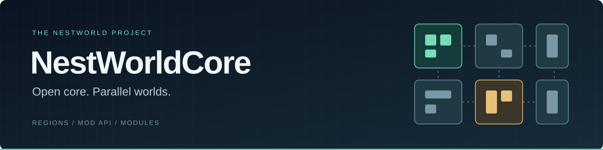

  

<h1 align="center">NestWorldCore</h1>

  <strong>Відкрите серверне ядро для модового Minecraft із паралельним виконанням регіонів.</strong> 
  Forge 1.20.1 · Порт на NeoForge 1.21.1 у розробці · Експериментальний статус

  <a href="docs/INDEX.md">Документація</a> ·
  <a href="ROADMAP.md">Roadmap</a> ·
  <a href="docs/compat/AE2-COMPATIBILITY-MATRIX.md">Сумісність AE2</a> ·
  <a href="https://nestworld.site/">Проєкт NestWorld</a>

---

## Навіщо це ядро

NestWorldCore народжується з потреб [NestWorld](https://nestworld.site/) — українського
ігрового проєкту на серверах Xeon. Мета — використовувати кілька ядер процесора
для модового світу, зберігаючи коректність його механік.

Світ поділяється на регіони з власною роботою та обміном повідомленнями.
Ядро керує володінням даними, адаптивним поділом і об’єднанням регіонів та бюджетами
виконання. Регіони працюють **в одній JVM зі спільною пам’яттю**; частина фаз
залишається на головному потоці.

## Що вже є

| Напрям | Можливості |
| --- | --- |
| **Регіони** | Паралельне виконання, адаптивні split/merge, mailbox та пакетна обробка повідомлень. |
| **Сумісність модів** | Домени виконання, tick pinning, адресні position pins, окремі адаптери AE2 і Mekanism. |
| **Mod API** | Обмежені операції `setVelocity` та inventory `setSlot`; окремі compile-time API і runtime provider. |
| **Модулі** | Версійований SPI, завантаження зовнішніх JAR із `nestworld-modules/` під час запуску. |
| **Продуктивність** | Бюджетування генерації чанків, оптимізація запуску, діагностика та відтворювані тести. |
| **Core / Adapter** | Розділення меж ядра й адаптерів; перевірені етапи порту на NeoForge 1.21.1. |

## Масштабування у вимірюваннях

**PERF-1A · 1 → 8 фізичних ядер · один сокет**

| Розділене навантаження W1 | Неподільний hotspot W2 |
| :---: | :---: |
| **8,409×** | **1,404×** |
| 36 864 AI-cows у 16 ізольованих клітинах | 7 680 cows в одному chunk-column |
| [Методика й результати W1](docs/performance/PERF-1A-R1-results.md) | [Методика й результати W2](docs/performance/PERF-1A-W2-results.md) |

Показано зміну пропускної здатності **самого NestWorldCore** від 1 до 8 ядер.
Це не порівняння зі звичайним Forge і не гарантія 20 TPS. Результати демонструють
як виграш від розподілу роботи, так і обмеження неподільного hotspot.

## Відкрите ядро та інструменти розширення

Ядро, API та Module SPI розвиваються відкрито. Розробники можуть використовувати
ці механізми для власних модулів та інтеграцій.

## Перед тестуванням

Проєкт експериментальний. Наявність Forge-мода не означає перевірену сумісність
із регіональним виконанням. `pinmod` переносить тіки сутностей і блокових сутностей
на main, але не весь код мода, capabilities чи зовнішні callbacks.

Тестуйте на копіях світів із резервною копією. Фіксуйте версії ядра, модів,
адаптерів та налаштування. Для AE2 звіряйте конкретну збірку з
[матрицею сумісності](docs/compat/AE2-COMPATIBILITY-MATRIX.md): інженерна перевірка
окремого механізму не означає готовність усього модпака до production.

## Знайти потрібне

| Для кого | Почати тут |
| --- | --- |
| **Власникам серверів** | [Керування сервером](docs/NESTWORLD-ADMIN.md) · [Сумісність модів](docs/MOD_COMPATIBILITY_FIXES.md) · [Адаптер Mekanism](compat/nestworld-compat-mekanism/CHANGELOG.md) |
| **Розробникам модів і модулів** | [Mod API та пакування](docs/PACKAGING.md) · [Зовнішні модулі](docs/MODULES.md) |
| **Дослідникам ядра** | [Архітектура](docs/ARCHITECTURE.md) · [Прогрес NeoForge](docs/B3_MIXIN_VERTICAL_SLICE.md) · [Roadmap](ROADMAP.md) |
| **Уся документація** | [Каталог і правила читання статусів](docs/INDEX.md) |

## Долучитися

Найкорисніші внески зараз — відтворювані помилки, перевірки модових механік
і порівняння продуктивності на однакових світах, модпаках та налаштуваннях.

<strong>Що додати до звіту про проблему</strong>

- Версію або commit ядра.
- Список і версії модів та адаптерів.
- Конфігурацію, модель CPU й виділену пам’ять.
- Кроки відтворення, очікувану та фактичну поведінку.
- Відповідні логи й результати вимірювань.

---

NestWorldCore базується на [Minecraft Forge](https://github.com/MinecraftForge/MinecraftForge)
і не є офіційним релізом Forge.
[Ліцензія](LICENSE.txt) · [Автори](CREDITS.txt) · [Оригінальна документація Forge](docs/README.md)
