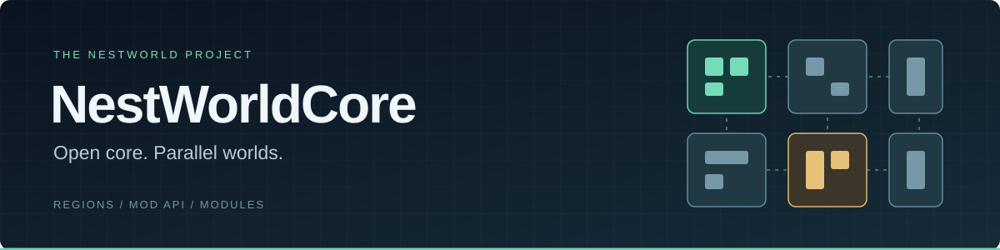

  

<h1 align="center">Roadmap</h1>

  <strong>Що працює сьогодні. Що перевіряємо. Куди рухається ядро.</strong> 
  Forge 1.20.1 · Порт на NeoForge 1.21.1 · Експериментальний статус

  <a href="README.md">Про ядро</a> ·
  <a href="#current">Поточний фокус</a> ·
  <a href="#completed">Виконані етапи</a> ·
  <a href="#next">Подальші напрями</a> ·
  <a href="docs/INDEX.md">Документація</a>

---

**Стан за документацією: 8 листопада 2026.** Оформлення оновлено 9 листопада 2026.
Етапи нижче показують стан роботи без обіцяних дат релізу.
Регіони виконуються в одній JVM зі спільною пам’яттю.

| Реалізовано | Відкриті роботи | Потребує окремого дизайну |
| --- | --- | --- |
| Регіональне виконання та mailbox | Сумісність екосистеми AE2 | Розширення політик GMEIL |
| Mod API та Module SPI | Порт NeoForge 1.21.1 | Повна заміна chunk scheduler |
| Batch apply та бюджети генерації | PERF-1B та коректність під навантаженням | Наступні контракти виконання |

## 🟡 Поточний фокус

### 01 · Сумісність модів

**Наступна ключова межа — спільне сховище та crafting AE2.** Від неї залежить
безпечне перенесення роботи машин на регіональні потоки. Чинний fallback — MAIN.

| Уже перевірено в окремих етапах | Наступні кроки |
| --- | --- |
| Lifecycle, topology, callback delivery, EnergyService і TickManager | Узгодити registry та матрицю → спроєктувати storage domain → перевірити обмежений import/export dispatcher |

<strong>План AE2, залежності та критерії перевірки</strong>

Актуальна точка входу — [архітектура від 2026-11-07](docs/compat/AE2-COMPAT-ARCHITECTURE.md)
і [матриця модів та перевірок](docs/compat/AE2-COMPATIBILITY-MATRIX.md).
Lifecycle, topology, callback delivery, EnergyService і TickManager мають уже
виконані етапи.

Ключова відкрита межа — спільний стан network storage та crafting. Виносити
машини на регіональні потоки до її закриття небезпечно; чинний fallback лишається MAIN.
Запропонований порядок робіт:

1. Узгодити compatibility registry, версійні gates і матрицю екосистеми.
2. Провести storage-domain audit/design та довести порядок блокувань.
3. Після цього реалізувати обмежений import/export dispatcher із transit-протоколом,
   одним незавершеним викликом на машину та телеметрією.
4. Перевірити збереження предметів/енергії/рідин, далі розширювати підтримку аддонів.
5. Звужувати блокування лише за результатами вимірювання конкуренції.

Це work-package plan; transit-протокол і machine offload ще не готові.
Інженерна перевірка D4a або допуск нової версії AE2 не дорівнюють production-сертифікації
всього модпака. [Аудит machine tick](docs/compat/AE2-MACHINE-TICK-DOMAIN-001-audit.md).

### 02 · NeoForge 1.21.1

**Порт уже виконує регіональну роботу.** Перевірено низку ігрових сценаріїв;
відкритою залишається, зокрема, інтеграція entity tracking / ChunkMap.

| Пройдені етапи | Що залишається |
| --- | --- |
| Регіональне виконання, player lifecycle, combat, block/item mutations, redstone, scheduled ticks і save guards | Закрити решту підсистем та перевірити їхню взаємодію |

<strong>Межі перевірок і журнал порту</strong>

Порт уже пройшов етапи справжнього регіонального виконання, player lifecycle,
combat, block/item mutations, redstone, scheduled ticks та інших категорій.
Ранні shell-only перевірки були переглянуті після виявлення, що core tick не виконувався.
Зараховуються повторні перевірки з активним ядром.

Залишаються відкриті частини, зокрема entity-tracking / ChunkMap pipeline;
успіх окремих категорій не означає завершений порт. Окремо перевірено save guards,
включно з відновленням після винятку.
Джерела: [актуальний журнал етапів](docs/B3_MIXIN_VERTICAL_SLICE.md),
[класифікація Core / Adapter](docs/CORE_ADAPTER_CLASSIFICATION.md),
[напрям залежностей](docs/DEPENDENCY_DIRECTION_AUDIT.md).

### 03 · Продуктивність і коректність

**PERF-1A завершено; окремий напрям PERF-1B залишається відкритим.**
Фокус — вартість API, затримки, backpressure і поведінка під навантаженням.
Окремо потрібно розслідувати випадки сутностей без визначеного власника.

<strong>Відкриті findings та правила подальших оптимізацій</strong>

Продовжувати окремий PERF-1B: вартість API, затримки та backpressure.
[Зафіксована межа](docs/contracts/PERF-1B-FINDING-001-cross-region-backpressure-ceiling.md)
стосується конкретного навантаження й політики admission, а не універсальної пропускної
здатності ядра чи доведеного bottleneck в ОЗП.

Не перезапускати закритий PERF-1A або відхилений coalescing без нової підстави.
Відкрите [ownerless entity finding](docs/contracts/CORE-ENTITY-OWNERLESS-001.md)
потребує власного розслідування. Нові зміни черг, layout повідомлень і cache locality
мають проходити вимірювання та перевірки порядку, міграції власності й збереження операцій.

## 🟢 Виконані етапи

Регіональне виконання, API, модульний loader, бюджети генерації й діагностика вже
мають реалізацію. Статус кожної перевірки стосується її конкретного контракту.

<strong>Реалізація, перевірені контракти та відомі обмеження</strong>

| Напрям | Результат і межі |
| --- | --- |
| Регіональне виконання | Ownership, split/merge, mailbox, перенаправлення визначених операцій, локальні тіки й бюджети. Наявність free-running не означає відсутності глобальних фаз або повної незалежності регіонів. |
| Обмін між регіонами | Batch apply вже реалізовано й виміряно; обраний розмір пакета — 16. Coalescing Phase 2 закрито з негативним результатом вимірювання, а не залишено обов’язковою наступною оптимізацією. |
| Домени BE та pinning | `BlockEntityExecutionDomain`, pin/pinmod і адресні position pins CORE-PINZONE-001. Адресний pin не є універсальною ізоляцією всіх callbacks або всього коду мода. |
| Mod API | Обмежені примітиви `setVelocity` та inventory `setSlot`; окремий API/provider. API-1B lifecycle закрито й перевірено, включно з integrated A→B isolation. Це статус конкретного контракту, не всіх можливих мутацій. |
| Пакування API | PKG-002 закрито: compile-time API відокремлений від runtime FML provider; зовнішній consumer перевірено на Forge і NestWorld. Публічний Maven-реліз із цих перевірок не випливає. |
| Зовнішні модулі | Module SPI, lifecycle і базова реалізація loader для `nestworld-modules/*.jar`. Завантаження під час запуску, без hot reload; повна negative matrix loader залишається окремою умовою production-релізу. |
| Генерація чанків | Реалізовано обмеження admission/promotion/concurrency та телеметрію. P1 закрито з обмеженнями: великий forceload ще знижував TPS, перевірка з реальним гравцем не замінюється proxy-сценарієм. |
| Запуск | Startup Optimization v1 завершено: у задокументованій збірці медіана 54,81 с проти приблизно 93 с. Це вимір конкретного модпака. |
| Цілісність патчів | SOURCE-PATCH-INTEGRITY-001 закрито й перевірено. Побітова відтворюваність збірок — окреме питання SOURCE-BUILD-REPRO-001. |

Докази: [batch apply](docs/BATCH_APPLY_COALESCING_DESIGN.md),
[API lifecycle](docs/contracts/API-1B-CLOSURE-lifecycle.md),
[пакування](docs/PACKAGING.md), [модулі](docs/MODULES.md),
[P1 results](docs/P1_5_RESULTS.md), [startup](docs/STARTUP_OPTIMIZATION_SPEC.md),
[цілісність патчів](docs/contracts/SOURCE-PATCH-INTEGRITY-001-spec.md).

### Результати PERF-1A

| Розділене навантаження W1 | Неподільний hotspot W2 |
| :---: | :---: |
| **8,409×** | **1,404×** |
| 16 ізольованих клітин · 36 864 AI-cows | Один chunk-column · 7 680 cows |

Пропускна здатність при переході **від 1 до 8 фізичних ядер** на односокетному
стенді. Порівняння самого NestWorldCore; не порівняння з Forge і не гарантія 20 TPS.

<strong>Методика, обмеження та чинні результати</strong>

**PERF-1A закрито, перевірено й заморожено.** Фінальна межа цього етапу — 8 фізичних ядер.

| Навантаження | Пропускна здатність на 8 ядрах відносно 1 | Висновок у межах тесту |
| --- | --- | --- |
| W1: 16 ізольованих клітин, 36 864 AI-cows | 8,409× | Розділене навантаження масштабується. Результат понад 8× не доводить універсального надлінійного масштабування. |
| W2: 7 680 cows в одному неподільному chunk-column | 1,404× | Локальний hotspot майже не виграє після 2 ядер. |

Це не порівняння зі звичайним Forge й не гарантія 20 TPS.
Вимірювання виконано на односокетному стенді. Первісний W1 був визнаний невалідним;
чинний результат — [W1 R1](docs/performance/PERF-1A-R1-results.md).
[W2 і рішення про закриття](docs/performance/PERF-1A-W2-results.md).

## ⚪ Подальші напрями

### Контракти виконання

GMEIL та повна заміна chunk scheduler потребують окремих етапів проєктування
і перевірки. Адресний pinning уже існує, але не забезпечує ізоляцію довільного коду мода.

<strong>Поточні межі механізмів і специфікації</strong>

GMEIL описує політики та подальші gates; спостереження не є готовою універсальною
ізоляцією модів. Старий next-tick callback router вимкнено через порушення
синхронної семантики. Наявні position pins не закривають довільні capabilities,
Forge callbacks або сторонній shared state.
[Контракт pinning](docs/contracts/CORE-PIN-DOMAIN-COMPLETENESS-001-audit.md),
[GMEIL](docs/gmeil/ARCHITECTURE.md).

Повна заміна chunk scheduling лишається [окремою специфікацією](docs/REGION_CHUNK_SCHEDULER_SPEC.md).

### Публічний тестовий випуск

Пропозиція щодо представлення проєкту; не затверджений календар релізу.

- [ ] Підготувати інструкцію встановлення з точними версіями ядра й адаптерів.
- [ ] Описати перевірені конфігурації та відомі обмеження.
- [ ] Додати відтворюваний приклад навантаження й коротку демонстрацію.
- [ ] Підготувати шаблон звіту для зовнішніх тестувальників.

Матриця AE2 вже існує — її потрібно підтримувати й показувати разом із результатами перевірок.

---

**Як читати статуси:** реалізація, перевірений окремий контракт та готовність
усього модпака до production — різні рівні готовності.

[Уся документація](docs/INDEX.md) · [Історичний roadmap від 2026-06-14](docs/history/ROADMAP-2026-06-14.md)
